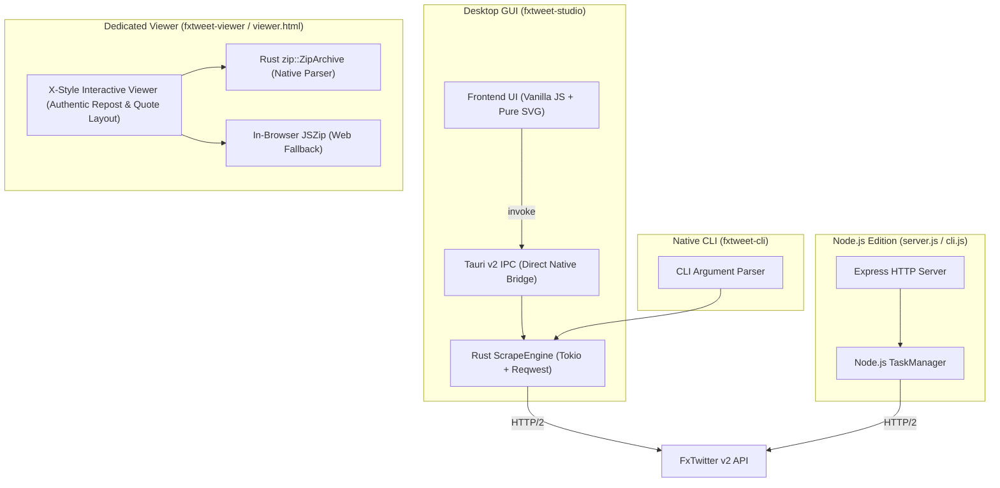

# FxTwitter Archive Studio - Technical Documentation

> **Created by Hikaproj**  
> Comprehensive System Architecture & Engineering Specification

---

## 1. システムアーキテクチャ概要

FxTwitter Archive Studio は、Twitter/X の公開投稿・メディアを高信頼性・高スループットでアーカイブするために設計されたデュアル・アーキテクチャを採用しています。



### アーキテクチャの基本方針
- **完全ネイティブ優先**: デスクトップ GUI (`fxtweet-studio`) は、外部 Node.js サーバーやローカル Web ポートを一切消費せず、Tauri の Native IPC を通じて Rust エンジンを直接呼び出します。
- **ゼロ絵文字 (Pure SVG)**: あらゆる UI コンポーネント、コンソールログ、生成テキストにおいて絵文字を完全排除し、ピュアなベクター SVG アイコンと視認性の高いタイポグラフィで統一。
- **高再現性ビューアーの同梱**: 出力データそのものが完全なポータブルアーカイブであり、専用ビューアー（デスクトップ統合ビューアーまたは `viewer.html`）により、ネットワーク環境が断絶された状態でも本家 X と同一の UI で閲覧可能。

---

## 2. ネイティブ Rust エンジン (`src-tauri/src/engine.rs`)

### 2.1 タイムライン取得パイプライン
1. **プロファイル解決**:
   - `https://api.fxtwitter.com/2/profile/:screen_name` および `https://api.fxtwitter.com/:screen_name` のデュアルエンドポイントを順次照会。
   - レスポンスが `<!DOCTYPE` や `<html` で始まる場合を自動検知し、API 障害や一時的レート制限による不正 JSON パースエラーを防止。
2. **ページネーション (Cursor-based)**:
   - 取得されたステータスレスポンス内の `cursor.bottom` を追跡し、ページ単位で重複なし（`seen_ids: HashSet<String>`）で収集。
3. **並列メディアダウンロード**:
   - `futures_util::stream::iter` と `.buffer_unordered(concurrency)` を用いた非同期並行パイプライン。
   - 画像クオリティ調整 (`orig`, `large`, `medium`, `small`) による高解像度画像の直接保存。
   - 動画ストリームの自動選別（最高ビットレート MP4 または指定解像度 MP4）。
4. **常時監視モード (Continuous Monitoring)**:
   - 指定したインターバル秒数（デフォルト: 30秒）でポーリングを実行。
   - 新規投稿が検出された場合、直ちにメディアを並列取得し、中間アーカイブおよびメタデータを自動保存。

---

## 3. Tauri ネイティブ IPC 仕様 (`src-tauri/src/commands.rs`)

デスクトップ GUI から呼び出し可能なネイティブコマンド仕様です：

### 3.1 `inspect_profile`
```rust
#[tauri::command]
pub(crate) async fn inspect_profile(handle: String) -> Result<UserProfile, String>
```
- **説明**: 指定ハンドルのプロファイル情報（名前、ID、紹介文、フォロワー数、鍵垢フラグ、アバター/ヘッダーURL）を FxTwitter API から取得して返却します。

### 3.2 `start_backup`
```rust
#[tauri::command]
pub(crate) async fn start_backup(
    state: State<'_, AppState>,
    config: ScrapeConfig,
) -> Result<String, String>
```
- **説明**: 指定された `ScrapeConfig` に基づき、Rust ネイティブエンジンでアーカイブ処理を実行します。
- **戻り値**: 生成されたアーカイブファイルの絶対パス（文字列）。

### 3.3 `stop_backup`
```rust
#[tauri::command]
pub(crate) async fn stop_backup(
    state: State<'_, AppState>,
) -> Result<bool, String>
```
- **説明**: 実行中のネイティブエンジンに対して安全な停止（Graceful Stop）シグナルを送信し、その時点までのデータを確定してアーカイブを作成させます。

### 3.4 `open_archive_native`
```rust
#[tauri::command]
pub(crate) async fn open_archive_native(file_path: String) -> Result<ArchivePayload, String>
```
- **説明**: 指定された `.zip` または `.xarchpjzip` ファイルを Rust の `zip::ZipArchive` でネイティブ解凍し、`tweets.json`、`profile.json`、`summary.json`、およびメディア一覧をメモリ上で抽出してビューアーへ直接渡却します。

### 3.5 `open_viewer_window`
```rust
#[tauri::command]
pub(crate) async fn open_viewer_window(app: tauri::AppHandle) -> Result<(), String>
```
- **説明**: 専用の独立ウィンドウ「FxTwitter Archive Viewer - by Hikaproj」をネイティブに生成またはフォーカスし、X 完全準拠のオフライン閲覧インターフェースを表示します。

---

## 4. アーカイブフォーマット仕様 (`.xarchpjzip`)

独自フォーマット **`.xarchpjzip`** は、標準的な Deflate 圧縮アルゴリズムを採用した自己完結型 ZIP アーカイブです。

```
<archive_name>.xarchpjzip
├── README.txt              # アーカイブ概要・作成者・メタ情報
├── tweets.json             # 取得された全ツイートの完全な JSON 配列
├── profile.json            # ユーザープロファイルメタデータ
├── summary.json            # 実行統計（取得数、メディア容量、所要時間等）
├── media/                  # 投稿に添付されていた画像・動画
│   ├── <tweet_id>_photo_1.jpg
│   ├── <tweet_id>_photo_2.jpg
│   └── <tweet_id>_video_1.mp4
└── profile_media/          # プロファイル画像
    ├── avatar.jpg
    └── banner.jpg
```

---

## 5. Retina 2x ツイート画像出力機能仕様

ビューアー上で各ツイートカードを PNG 画像として書き出すレンダラーは、以下の仕様に基づき動作します：

- **解像度**: 2.0x Retina スケール（標準幅 598px × 2 = 1196px）
- **タイポグラフィ**: システムネイティブフォント（-apple-system, BlinkMacSystemFont, Segoe UI, Roboto, Hiragino Kaku Gothic ProN, Meiryo）
- **メディア描画**: 添付写真の比率を維持したクリッピングおよびラウンドコーナー処理
- **完全ローカル処理**: 外部 API や外部サーバーへの画像データ送信は一切発生せず、ブラウザ内 HTML5 Canvas で完結。

---

## 6. 製作者 (Author)

**Hikaproj** (All Rights Reserved)
