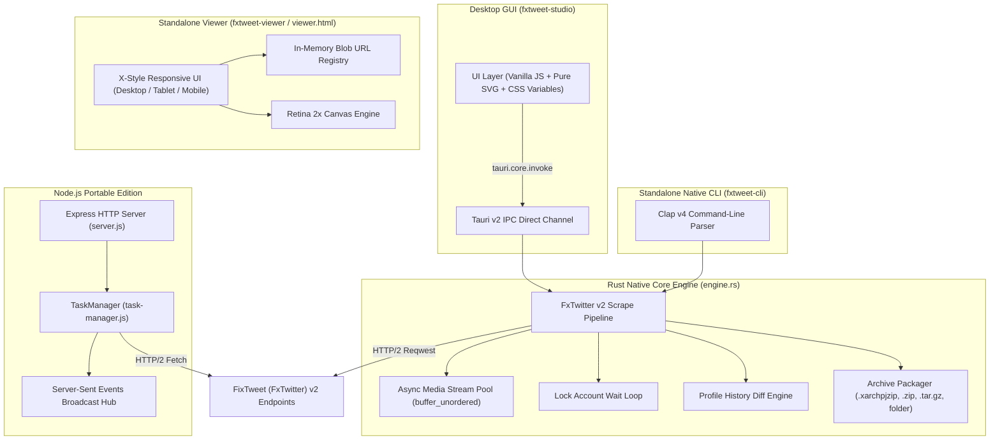

# FxTwitter Archive Studio - Technical Documentation

> **Created by Hikaproj**  
> **Comprehensive System Architecture & Engineering Specification**

---

## 目次

1. [システムアーキテクチャ概要](#1-システムアーキテクチャ概要)
2. [Rust ネイティブコアエンジン (`src-tauri/src/engine.rs`)](#2-rust-ネイティブコアエンジン-src-taurisrcenginers)
   - [2.1 タイムライン取得パイプラインとカーソル制御](#21-タイムライン取得パイプラインとカーソル制御)
   - [2.2 並行メディアダウンローダー](#22-並行メディアダウンローダー)
   - [2.3 鍵垢 (非公開) 耐性と自動復帰ステートマシン](#23-鍵垢-非公開-耐性と自動復帰ステートマシン)
   - [2.4 プロフィール動的監視 & 差分履歴記録](#24-プロフィール動的監視--差分履歴記録)
   - [2.5 保存先ディレクトリ解決メカニズム](#25-保存先ディレクトリ解決メカニズム)
3. [Tauri v2 ネイティブ IPC 仕様 (`src-tauri/src/commands.rs`)](#3-tauri-v2-ネイティブ-ipc-仕様-src-taurisrccommandsrs)
4. [アーカイブフォーマット仕様 (`.xarchpjzip` & 他形式)](#4-アーカイブフォーマット仕様-xarchpjzip--他形式)
5. [オフライン X ビューアー設計仕様 (`public/viewer.html`)](#5-オフライン-x-ビューアー設計仕様-publicviewerhtml)
   - [5.1 モバイルレスポンシブ変換機構](#51-モバイルレスポンシブ変換機構)
   - [5.2 メモリ内 Blob ストアと完全オフライン再生](#52-メモリ内-blob-ストアと完全オフライン再生)
   - [5.3 本家ライクなリポスト・引用ツイート描画](#53-本家ライクなリポスト引用ツイート描画)
   - [5.4 Retina 2x 高解像度 PNG カード書き出しエンジン](#54-retina-2x-高解像度-png-カード書き出しエンジン)
6. [Node.js エディション (`server.js` / `lib/task-manager.js`)](#6-nodejs-エディション-serverjs--libtask-managerjs)
7. [製作者 & ライセンス](#7-製作者--ライセンス)

---

## 1. システムアーキテクチャ概要

FxTwitter Archive Studio は、Twitter/X の公開データおよびメディアを高スループット・高信頼性で収集するために設計されたマルチターゲット・アーキテクチャを採用しています。



### コア設計原則
1. **完全ネイティブ最優先**:
   デスクトップアプリケーション（`fxtweet-studio` および `fxtweet-viewer`）はローカル Node.js プロセスやローカル Web サーバーのポート開放を一切行わず、Tauri v2 による OS ネイティブ IPC を経由して Rust コアエンジンを直接駆動します。
2. **完全脱絵文字 (Pure SVG アイコン)**:
   すべてのインターフェース、プログレスバー、ステータスバッジ、ターミナルログ、画像エクスポートにおいて Unicode 絵文字を一切使用せず、緻密な SVG ラインアイコンと等幅フォント数値表示を採用しています。
3. **データ完全ポータビリティ**:
   生成されたアーカイブ（`.xarchpjzip` または `.zip`）は、ツイート本文・プロファイル情報・変更履歴・添付画像・動画をすべて内包しており、スタンドアロンビューアーやブラウザ単独で完全オフライン閲覧が可能です。

---

## 2. Rust ネイティブコアエンジン (`src-tauri/src/engine.rs`)

### 2.1 タイムライン取得パイプラインとカーソル制御
タイムラインの収集は FixTweet v2 のカーソルベース・ページネーションに従って実行されます：

1. **プロファイル解決 & HTML フォールバック保護**:
   `https://api.fxtwitter.com/2/profile/:screen_name` を照会。万一 FxTwitter がメンテナンス中等で HTML エラー（`<!DOCTYPE` や `<html`）を返却した場合、エンジンは即座にエラー文字列を補足し、不正 JSON パースクラッシュを未然に防ぎます。
2. **カーソルループ (`cursor.bottom`)**:
   取得したレスポンスの `cursor.bottom` を次のクエリパラメータとして逐次リクエストを送信。
3. **重複排除 (`HashSet<String>`)**:
   過去に取得済みのツイート ID をインメモリハッシュセットで厳密に追跡し、リツイートやピン留め投稿による二重取得を完全に排除します。

### 2.2 並行メディアダウンローダー
添付画像および MP4 動画のダウンロードは、Tokio 非同期ランタイムと `futures_util::stream::iter` の `buffer_unordered(concurrency)` を用いて高並列に処理されます：
- **画像 URL 最適化**:
  設定された `image_quality`（`orig`, `large`, `medium`, `small`）に基づき、Twitter の CDN URL 末尾（`:orig`, `:large` 等）を自動調整。
- **動画ストリーム自動選別**:
  複数のビットレートが提供される MP4 バリアントの中から、指定された `video_quality`（`highest`, `1080p`, `720p`, `480p`, `lowest`）に最も合致する最適な URL を自動解析してダウンロード。
- **ファイル名衝突防止**:
  `<tweet_id>_photo_<index>.jpg` および `<tweet_id>_video_<index>.mp4` の命名規則で確実に一意化。

### 2.3 鍵垢 (非公開) 耐性と自動復帰ステートマシン
スクレイピング対象のアカウントが非公開（鍵垢）であった場合、またはスクレイピングの途中で突然非公開に設定された場合、エンジンは異常終了せず待機ステートへ遷移します：

```
+------------+       HTTP 401 / Protected       +------------+
|  FETCHING  | -------------------------------> |   LOCKED   |
+------------+                                  +------------+
      ^                                               |
      |             Account Becomes Public            |
      +-----------------------------------------------+
```

- 待機中は定期的にプロファイルエンドポイントを軽量照会。
- アカウントが公開されたことを検知すると、保存していたカーソル位置から自動的にタイムライン収集をシームレスに再開します。

### 2.4 プロフィール動的監視 & 差分履歴記録
常時監視モード中、ユーザー名・表示名・自己紹介文（Bio）・アバター画像・ヘッダー画像の変更を逐次比較監視します。
変更が検知された場合、`profile_history.json` にタイムスタンプ・変更前後の値・新規画像ファイルパスをスナップショットとして追記保存します。

### 2.5 保存先ディレクトリ解決メカニズム
GUI の「保存先フォルダ」または CLI の `-o / --out` オプションで渡されたパスをパースし、親ディレクトリが存在しない場合は `std::fs::create_dir_all` で安全に自動生成します。相対パス（例: `./output`）が指定された場合は、プロセスのカレントワーキングディレクトリを基準に絶対パスへ正規化して処理します。

---

## 3. Tauri v2 ネイティブ IPC 仕様 (`src-tauri/src/commands.rs`)

デスクトップフロントエンドと Rust コアエンジンは、以下の Tauri IPC コマンドを通じて通信します：

| コマンド名 | 引数 | 戻り値 | 説明 |
| :--- | :--- | :--- | :--- |
| `inspect_profile` | `handle: String` | `Result<UserProfile, String>` | 指定アカウントのメタデータ（名前、フォロワー数、鍵垢状態等）を取得 |
| `start_backup` | `config: ScrapeConfig` | `Result<String, String>` | バックアップジョブを開始。完了時に生成アーカイブのフルパスを返却 |
| `stop_backup` | なし | `Result<bool, String>` | 実行中のジョブに停止シグナルを送信し、安全に終了させる |
| `open_archive_native` | `file_path: String` | `Result<ArchivePayload, String>` | ZIP または `.xarchpjzip` をネイティブ解凍し、JSON とメディア構造を抽出 |
| `open_viewer_window` | なし | `Result<(), String>` | 独立ビューアーウィンドウを生成またはフォーカス表示 |

### `ScrapeConfig` データ構造
```rust
#[derive(Debug, Clone, Serialize, Deserialize)]
pub struct ScrapeConfig {
    pub users: Vec<String>,
    pub output_dir: Option<String>,
    pub export_format: String,        // "xarchpjzip", "zip", "tar.gz", "tar", "folder"
    pub concurrency: usize,           // 1..=32
    pub download_images: bool,
    pub download_videos: bool,
    pub image_quality: String,        // "orig", "large", "medium", "small"
    pub video_quality: String,        // "highest", "1080p", "720p", "480p", "lowest"
    pub include_replies: bool,
    pub include_retweets: bool,
    pub include_quotes: bool,
    pub direction: String,            // "newest", "oldest"
    pub continuous: bool,
    pub interval: u64,
}
```

---

## 4. アーカイブフォーマット仕様 (`.xarchpjzip` & 他形式)

### 独自形式 `.xarchpjzip`
`.xarchpjzip` は、Deflate 圧縮アルゴリズムを採用した完全自己解凍対応の ZIP アーカイブ規格です。拡張子を `.zip` に変更することでも一般的な解凍ソフトウェアで展開可能です。

```
<screen_name>_<timestamp>.xarchpjzip
├── README.txt              # アーカイブ作成日時、ツールバージョン、製作者 (Hikaproj)
├── tweets.json             # 取得ツイート配列 (本家準拠フィールド)
├── profile.json            # 取得時最新のユーザープロフィール情報
├── profile_history.json    # 監視中に生じたプロフィール変更の時系列差分リスト
├── summary.json            # 実行統計情報 (ポスト数、メディア総バイト数、所要時間)
├── media/                  # 投稿添付写真・動画ファイル
│   ├── 123456789_photo_1.jpg
│   └── 123456789_video_1.mp4
└── profile_media/          # アバター・ヘッダー画像
    ├── avatar.jpg
    └── banner.jpg
```

---

## 5. オフライン X ビューアー設計仕様 (`public/viewer.html`)

### 5.1 モバイルレスポンシブ変換機構
ビューアーは CSS Flexbox および Grid を駆使し、3段階のブレークポイントでレイアウトを適応変形させます：

- **デスクトップ (幅 > 1024px)**:
  - 3 カラム構成: 左（ナビゲーションバー） / 中央（最大 600px タイムライン） / 右（アーカイブ情報・操作パネル）
- **タブレット (幅 768px - 1024px)**:
  - 右側パネルを非表示または下部へ退避し、タイムラインの閲覧性を優先。
- **モバイルスマートフォン (幅 < 768px)**:
  - 左側ナビゲーションが非表示となり、画面最下部に「固定ボトムナビゲーションバー」として出現。
  - ホーム、メディア、返信、テーマ切替が指先で操作可能な 48px タッチターゲットとして配置。
  - タイムラインが横幅 100% の edge-to-edge 表示となり、ヘッダー・アバター・本文パディングがスマホ画面に最適化。

### 5.2 メモリ内 Blob ストアと完全オフライン再生
ZIP または `.xarchpjzip` が読み込まれると、JavaScript 内の `cachedBlobs` レジストリがアーカイブ内のバイナリデータを `URL.createObjectURL` によりメモリ内 URL へマッピングします。
これにより、外部ネットワーク接続が一切ない環境でも、画像の高解像度表示や HTML5 `<video>` タグでの MP4 ストリーミング再生が途切れることなく機能します。

### 5.3 本家ライクなリポスト・引用ツイート描画
- **リポスト (Retweet)**:
  ツイートカード上部に、本家 X と同一カラー（`#00BA7C`）の SVG リポスト矢印アイコンと「[ユーザー名] さんがリポスト」のヘッダーを表示。カード本体には元ツイートのアイコン、名前、本文、画像が忠実に描画されます。
- **引用ツイート (Quote Tweet)**:
  本文の下部に、1px の繊細なボーダーと 12px 角丸で構成された埋め込みカードを配置し、引用元投稿をインライン表示します。

### 5.4 Retina 2x 高解像度 PNG カード書き出しエンジン
各ツイートカードに配置された「画像出力」ボタンを押すと、HTML5 Canvas 2D レンダラーが起動します：
- **スケール**: 2.0x Retina 解像度（標準 598px × 2 = 1196px 幅）。
- **描画プロセス**:
  1. 背景およびカード境界線の描画。
  2. 円形クリッピングによるアバター描画。
  3. システムフォントを用いたタイトル、スクリーンネーム、本文テキストの自動折り返しレンダリング。
  4. 添付画像の比率計算と角丸クリッピング描画。
  5. タイムスタンプおよびアクションアイコンのレイアウト。
- **出力**: PNG Blob として生成され、ファイル名 `<tweet_id>_card.png` で即時ダウンロードされます。

---

## 6. Node.js エディション (`server.js` / `lib/task-manager.js`)

Node.js 環境向けには、Express を基盤とした軽量サーバーおよび CLI を提供しています：
- **Server-Sent Events (SSE)**:
  `/api/task/events` エンドポイントを通じて、フロントエンドへリアルタイムにログ、進捗率、新着ツイート、完了イベントをブロードキャスト。
- **マルチタスク管理**:
  `TaskManager` クラスがアカウントごとの並列タスクキューを管理し、カスタム保存先パス（`outputDir`）およびアーカイブ形式（`format`）に準拠したアーカイブ生成を行います。

---

## 7. 製作者 & ライセンス

- **Author**: **Hikaproj** (All Rights Reserved)
- **License**: MIT License
